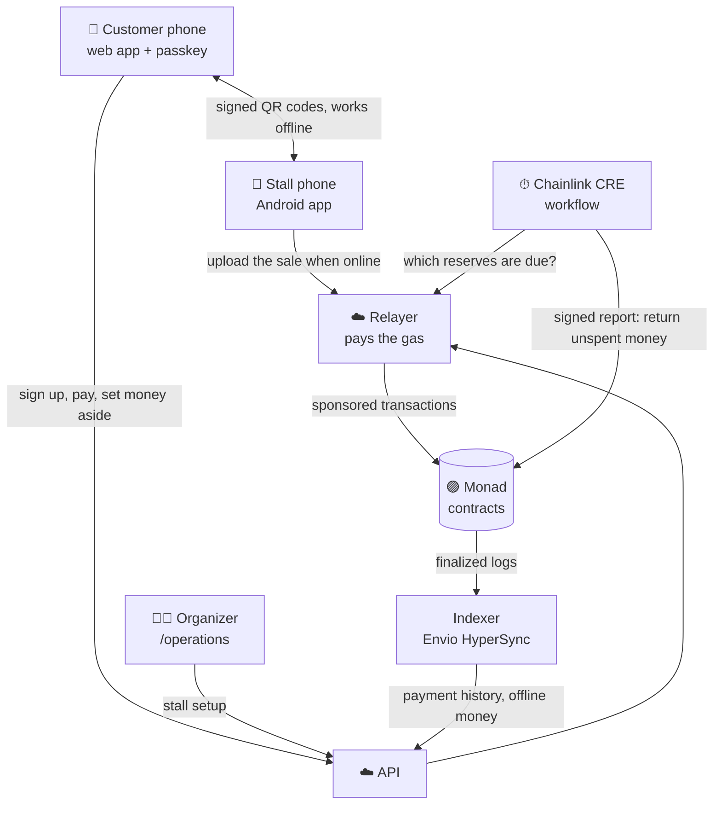

<div align="center">
  
  <h1>OpenBalance</h1>
  <p><strong>Event payments that keep working with no signal.</strong><br/>
  Pay stalls with a passkey, and get back whatever you do not spend, under rules the organizer cannot change.</p>

  [](https://openbalance.countersign.site)
  [](https://youtu.be/uYLsujI-8x0)
  [](https://youtu.be/IL1zGnZknXs)
  [-3DDC84?style=for-the-badge)](https://drive.google.com/file/d/1iVjBrYNDqoIV3lIwnwNHjduCrYUzdRiZ/view?usp=sharing)

  -836EF9)
  
  
  [](LICENSE)
</div>

> **Monad Metropolis 2026 · Consumer Products & Payments.** Live on Monad testnet with test USDC.
> Every flow below was tested on real phones against the deployed system.

---

## 💡 The problem

- At festivals and markets you prepay into a balance the **organizer** holds (a wristband or an app).
  Leftover money comes back only through their refund process, often with a fee or a short window.
- When the mobile network is overloaded, which is when the event is busiest, **payments stop**.
- Today's offline modes just move the risk: wristbands work offline because the organizer holds
  your money, and card offline modes make the stall carry the loss.

## ✨ What it does

| | |
|---|---|
| 🔑 **Sign up with a passkey** | The phone's screen lock is the key. No wallet app, no seed phrase, no gas: every transaction is sponsored. |
| 📱 **Pay online** | The stall phone shows a QR code. The customer scans it, checks the amount and approves. The stall sees *Paid* once it is final on Monad. |
| 📴 **Pay with no signal** | While online, the customer sets a small amount aside for one stall. With no network on either phone, the two phones swap signed QR codes. The stall phone uploads the sale later and it settles on chain. |
| ↩️ **Unspent money comes back** | When the reserve closes, the rest returns to the customer's own account. A Chainlink CRE workflow does it automatically; anyone can also trigger it. |
| 🏪 **Stall setup** | The organizer invites a stall, the owner signs their own payout wallet, the organizer registers it on chain and approves the stall's phone. |

Every sale splits on chain between the stall, the organizer (2%) and the platform (1%).

**Users:** customers use the web app in their phone's browser, stall owners use the Android app,
and organizers use `/operations`.

---

## 🧭 How it works



**Why offline payments are safe**

1. The customer's money for a stall is **locked on chain** for that one stall's phone, so it cannot
   be spent twice.
2. The customer's phone signs a payment against it. The stall phone **rebuilds the same payment
   from its own records** before countersigning, so it trusts nothing the customer's phone claims.
3. The contract settles it only with **both signatures**, in order, within the locked amount and
   before the upload deadline.
4. Whatever is not spent goes back to the customer. The organizer cannot keep it, redirect a
   stall's payout, or block a return: there is no admin sweep or upgrade key.

---

## 🟣 Why Monad

- **Native P-256 precompile (EIP-7951).** Passkey signatures are verified on chain for every
  account command, an estimated ~33,000 gas versus ~330,000 for a Solidity verifier. This is what
  makes a passkey account practical per purchase.
- **Fast finality.** An online payment completes within a normal card-terminal wait.
- **Low gas.** We can sponsor every customer and stall transaction.
- **Gas is charged on the declared limit**, so the relayer and the CRE report size their gas limits
  from measurement and batch size. A pool of signing keys keeps each sender within Monad's reserve
  balance rule.

### Contracts on Monad testnet (chain 10143)

All source-verified on the explorer (Sourcify full match). Settlement asset: Circle test USDC
`0x534b2f3A21130d7a60830c2Df862319e593943A3`.

| Contract | Address |
|---|---|
| AccountFactory | [`0x26F40f1Bf42fAe9bE48A8b3102bc28649004714e`](https://testnet.monadexplorer.com/address/0x26F40f1Bf42fAe9bE48A8b3102bc28649004714e) |
| Account implementation | [`0xAd5A30F795F9D2B92d7Ed49fdf7F63EAD34d5481`](https://testnet.monadexplorer.com/address/0xAd5A30F795F9D2B92d7Ed49fdf7F63EAD34d5481) |
| EventFactory | [`0xb052f9D827777B5C912a55954e7a58B3EAB3c281`](https://testnet.monadexplorer.com/address/0xb052f9D827777B5C912a55954e7a58B3EAB3c281) |
| EventRegistry | [`0x4bD8E4386e6a3DB1c63b145D812CD7eFE0bd9485`](https://testnet.monadexplorer.com/address/0x4bD8E4386e6a3DB1c63b145D812CD7eFE0bd9485) |
| SettlementLedger | [`0xecCc97B6fcaAbbC5071d2BaE80bc47F12A469FA8`](https://testnet.monadexplorer.com/address/0xecCc97B6fcaAbbC5071d2BaE80bc47F12A469FA8) |
| ExactPayRouter | [`0x6e83eecB0DA3b6366e8F4ee8E1Fa8FB39f4e31D2`](https://testnet.monadexplorer.com/address/0x6e83eecB0DA3b6366e8F4ee8E1Fa8FB39f4e31D2) |
| ResilienceVault | [`0x1537AdeD24e15fddC773172C263335B456Ae2E5A`](https://testnet.monadexplorer.com/address/0x1537AdeD24e15fddC773172C263335B456Ae2E5A) |
| ReclaimTrigger (CRE consumer) | [`0x593c5Cf0250CFf0942D344B9F943AB4A4267f015`](https://testnet.monadexplorer.com/address/0x593c5Cf0250CFf0942D344B9F943AB4A4267f015) |

### Proof on chain

Real transactions from the deployed system, all successful.

| What happened | Transaction |
|---|---|
| Online payment from a passkey account (12 Oct) | [`0x20b65fb9…ac38`](https://testnet.monadexplorer.com/tx/0x20b65fb9d104b8692e63917c4d29aef7d25ee4d42432166937590c59f0feac38) |
| Money set aside for a stall (12 Oct) | [`0xd5467835…693a`](https://testnet.monadexplorer.com/tx/0xd54678356012224771663dacb771e05f2a40031f0aaba14916ced57a3189693a) |
| Offline sale settled from the stall phone's upload (12 Oct) | [`0x0cbbecbf…3f41`](https://testnet.monadexplorer.com/tx/0x0cbbecbfd857b3c4a6763fcfdc12544e23b7c0eb81abfcadc3ccb612e2aa3f41) |
| First two-phone offline sale settled (9 Oct) | [`0xaf252752…0360`](https://testnet.monadexplorer.com/tx/0xaf252752ca696cf0d48bf28e08bdbf3ab97dfde2547c9f67ae60877525bf0360) |
| Unspent money returned by the CRE workflow (12 Oct) | [`0x6cb6da91…eb06`](https://testnet.monadexplorer.com/tx/0x6cb6da91368008364377872deb7e78bbd98ef2c818be7938f2492b8441eceb06) |
| One CRE report returning 6 reserves (11 Oct) | [`0x3ee077c9…e280`](https://testnet.monadexplorer.com/tx/0x3ee077c991ce03c7413ac54105631596296cf131726b8e5ff8676ccab5dde280) |

---

## 🔗 Sponsor integrations

- **Chainlink CRE.** A cron workflow ([`cre/reserve-return`](cre/reserve-return)) lists due
  reserves from our relayer (HTTP with consensus), re-checks each one on chain at the finalized
  block in one Multicall3 read, and sends one signed report to `ReclaimTrigger`, which returns the
  money. It runs with `cre workflow simulate --broadcast`, sending real Monad testnet transactions
  every 3 minutes from a timer on our machine. It is not deployed to a Chainlink DON.
- **Envio HyperSync.** The deployed indexer's source of finalized logs. It feeds the customer's
  payment history and offline money in the Wallet. Heads, block hashes and balance checks stay on RPC.

---

## ✅ What was tested

On real phones against the deployed system, 9 to 13 Oct 2026:

- Passkey sign-up, sponsored account creation, sign-in and test money
- Online payment: one scan, passkey approval, *Paid* on the stall phone, and *Cancel sale*
- Offline payment with **both phones in airplane mode**, settling by itself once the stall phone
  was back online; the customer app opening with no signal
- Automatic return of unspent money by the CRE workflow, including after a partial spend
- Onboarding of new stalls on new phones: invite, owner signature, registration, phone pairing and
  approval (4 stalls are live)

By script against the deployed services: refund and stall payout withdrawal.

**Limits:** testnet and test USDC only, not audited. The CRE workflow runs as a simulation on our
machine and stops when it is off. Account recovery exists in the contracts but has no app screen yet.

---

## 🚀 Try it

No wallet, seed phrase or gas needed. Use Chrome, Safari or Edge on a phone or laptop.

1. Open <https://openbalance.countersign.site> and tap **Create an account**. Your passkey is
   your phone's screen lock.
2. In the Wallet, open **Add test money** and add 1, 2 or 5 test USDC.
3. Open **Add money in advance for offline payments**, pick a stall and an amount, and approve.
4. Paying needs a registered stall phone. That part is in the [demo video](https://youtu.be/uYLsujI-8x0).
   To run a stall yourself, install the [stall app](https://drive.google.com/file/d/1iVjBrYNDqoIV3lIwnwNHjduCrYUzdRiZ/view?usp=sharing)
   (Android, "install unknown apps"); the organizer must invite and approve it from `/operations`.
   Organizer access for judges is in the private submission notes.
5. Money you set aside and do not spend comes back by itself about 2½ hours later
   (2 hours to spend, 30 minutes for the stall to upload).

---

## 🛠 Tech stack

| Layer | Built with |
|---|---|
| Contracts | Solidity 0.8.37, Foundry, OpenZeppelin |
| Backend | TypeScript, Node.js 24, Fastify, PostgreSQL (Neon), viem, zod, OpenTelemetry |
| Web app | Next.js, React, SimpleWebAuthn, ZXing, an offline service worker |
| Stall app | Kotlin, Jetpack Compose, CameraX, ML Kit, Room, WorkManager, web3j, Android Keystore |
| Sponsors | Chainlink CRE (TypeScript SDK), Envio HyperSync |
| Cloud | Google Cloud Run and Compute Engine, Secret Manager, Terraform |

## 📁 Repository

```text
contracts/          Solidity contracts and Foundry tests
cre/                Chainlink CRE reserve-return workflow
services/api        Payment API: identity, checkout, stall onboarding
services/relayer    Sponsored transactions and the financial worker
services/indexer    Finalized-log indexer (Envio HyperSync) and reconciliation
apps/web            Customer and organizer web app (Next.js)
apps/terminal-android  Stall phone app (Kotlin)
packages/           Shared protocol, offline wallet, terminal core and verifier code
deployments/        Deployment manifests binding each address to its bytecode
infra/              Terraform for the cloud deployment
```

## 🏃 Run it locally

Requirements: Node.js 24, pnpm 12, Foundry and Docker. The Android app needs JDK 17 and Android SDK 37.

```bash
pnpm install
pnpm check      # lint, type checks, contract formatting
pnpm test       # tooling, package and Foundry contract tests
pnpm build      # all packages and contracts

# Stall app (debug APK)
cd apps/terminal-android && ./gradlew :app:assembleDebug
```

The web app reads its endpoints from `apps/web/.env.example`. Testnet deployment, CRE, Envio and
provisioning steps are in the [full reference](docs/REFERENCE.md).

---

## 🤖 AI tool disclosure

AI coding tools were used : Kiro (an AI IDE) for code generation, refactoring, tests,
debugging, documentation and research. AI-written code was reviewed and run against tests and the
deployed system before it was kept.

## 📚 Attribution

All application code was written during the hackathon (first commit 10 Sep 2026); no pre-existing
product code is included. Built on open-source libraries under their own licenses: OpenZeppelin
Contracts, Foundry, viem, zod, Fastify, node-postgres, OpenTelemetry, Next.js, React, SimpleWebAuthn,
ZXing, `qrcode`, Chainlink CRE SDK, Envio HyperSync, Jetpack Compose, CameraX, ML Kit, Room,
WorkManager, web3j and Bouncy Castle. Uses Circle test USDC, the Monad public RPC and QuickNode.

Our code is [MIT licensed](LICENSE).
