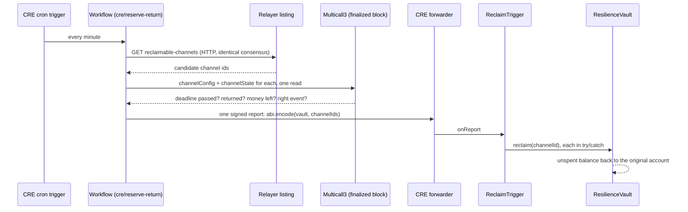

# openbalance

Application source for OpenBalance: contracts, API, relayer, indexer, venue relay, web, and Android
terminal. Product context and the full specification live in the workspace root
[`../README.md`](../README.md) and [`../ARCHITECTURE.md`](../ARCHITECTURE.md); this file documents
only what exists in this repository and how to run it.

## Status

Contract, protocol, API, relayer, indexer, venue relay, terminal, and web packages are implemented
and locally tested (`pnpm check`, `pnpm test`). The account and event contract set is deployed and
verified on Monad testnet. The API, relayer, indexer, financial worker and web app run against that
manifest on the testnet project, and the attendee journey — passkey enrollment, sponsored account
deployment, sign-in, test funding, reserve channel, voucher settlement, reclaim, refund and vendor
withdrawal — is proven against those deployed services on chain. On 9 Oct 2026 a full offline sale
was proven between two real phones: an attendee phone on the web wallet and the Android terminal,
with the terminal uploading straight to the cloud relayer (no laptop, no CLI). The integration worker
is not deployed. The venue relay is optional on-site fallback rather than a required component; see
the root checklist.

## Try it on Monad testnet (about 5 minutes)

Everything below runs against the deployed services at `https://openbalance.countersign.site`.
No wallet, seed phrase, or gas is needed; every transaction is sponsored and uses test USDC only.
Use a browser with a platform passkey (Chrome, Safari, or Edge on a phone or laptop).

1. **Create an account** — open `/enroll`, choose *Create passkey* and confirm it twice, then
   *Create my account*. Sponsorship pays the deployment and the page moves on by itself once the
   account contract is on chain.
2. **Get test money** — open `/account` (*Wallet* tab), *Sign in with passkey* (nothing to type;
   pick the passkey you just created), choose 1, 2 or 5 USDC and tap *Add*. Each account may draw
   at most 10 USDC in total and the faucet has a shared daily budget; the page says which limit
   refused a request.
3. **See it on chain** — *Activity* lists finalized payments, reserves and returns with amount,
   stall and time, 10 per page; each row links to its transaction on the Monad testnet explorer.
4. **Check it without us** — open `/verify`, keep the public RPC or paste your own, paste
   `deployments/testnet/verifier-manifest.json`, then *Verify deployment* and the custody check.
   The page reads the chain directly and never calls our API.

**Set aside for outages** on `/account` opens a reserve for one stall: pick the stall (from the
public `GET /v1/reserve-terms`) and 1, 2 or 5 USDC, then approve with the passkey. *Pay offline*
(`/offline`) then pays that stall by scanning the terminal's code, even with no signal. Paying needs
the registered stall terminal (the Android app), so that step is shown in the demo video. Demo
reserves accept payments for 60 minutes and give the stall 30 more minutes to upload, so unspent
money is returnable 90 minutes after the reserve opens. `/account` lists each offline balance, 5 per
page from `GET /v1/accounts/me/reserves` (cursor paginated), with when it can be spent and when the
rest comes back, and offers *Return now* once it is due. Anyone can trigger the return, from
`/account` or with no account at all (see *Reserve return* below).

The attendee pages and the terminal use plain words only: no addresses, hashes, "channel",
"voucher" or "testnet" in the main flow. Errors pass through one translator (`friendlyError` in
`apps/web/src/lib/account-display.ts`, `friendlyMessage` on the terminal) so an internal message is
never shown as-is. `/operations`, `/verify` and `/cashier` are organizer and auditor tools and keep
technical detail on purpose.

An organizer signs in to `/operations` with an access key and sees only stall setup: invite a stall,
the owner fills in `/stall/join` and signs their own payout address, the organizer registers it from
the organizer wallet, and approves the stall's phone once it checks in. The owner's invite link
stays their status page: after registration it shows the terminal setup code, so the owner pairs
the phone remotely (Terminal app → ⋮ → *Scan setup code*). The stall then appears in the
attendee's stall list. A stall whose phone was since set up for another stall is hidden until it is
paired again. The event's offline reserves (`GET /v1/events/:eventId/reserves`),
reconciliation and incidents stay in the API and on the page for other roles, but are hidden from the
organizer view. Organizer access keys are issued with
`services/api/src/provision-operations-access.ts`; the API stores only the key's SHA-256 hash.

## Business model

Every sale is split on-chain by the payment router at the moment it settles: 1% platform fee to
OpenBalance and 2% organizer fee to the event, and the rest to the stall. No invoicing or manual
payout is involved. On testnet both fee destinations point to the organizer wallet. Later revenue:
a monthly organizer plan and terminal rental.

## Layout

```text
contracts/          Solidity sources, Foundry config and tests
cre/                Chainlink CRE project: the scheduled reserve-return workflow
packages/
  protocol/         Shared typed encoding, boundary validation, ABI
  verifier/         Independent finalized-state / deployment-binding verifier core
  attendee/         Attendee offline wallet (device key, QR codec, authorization state machine)
  terminal/         Venue terminal core (journal, QR codec, time-confidence policy)
  sdk/              Typed TypeScript SDK over the API
  mcp/              MCP server exposing the SDK as tools over stdio JSON-RPC
  scenario/         Deterministic virtual-WebAuthn authenticator and process-level scenarios
  observability/    OpenTelemetry setup shared by the services
services/
  api/              Fastify payment API: intents, identity, consent, migrations
  relayer/          Sponsored command signing, financial worker, vendor treasury actions
  indexer/          Finalized-log indexing, PostgreSQL projections, reconciliation
  venue-relay/      Independent local process retaining and forwarding signed receipts
  integrations/     pretix and ERPNext adapters
apps/
  web/              Next.js attendee, cashier, organizer, finance and support flows
  terminal-android/ Kotlin Android terminal application
scripts/            Deployment, verification, workload, evidence and tooling scripts
deployments/        Bytecode-bound deployment manifests (per environment)
infra/              Terraform templates for the cloud deployment
contract/           OpenAPI 3.1 contract and generated types
```

## Requirements

- Node.js `>=24.21.0 <25`, pnpm `>=12.3.4 <13` (pinned in `package.json#engines`)
- Foundry (`forge`, `cast`) — resolved through `scripts/foundry-bin.mjs` rather than bare `forge`,
  because some environments have a same-named binary earlier on `PATH`
- Docker, for the disposable PostgreSQL used by `verify:postgres` and the system harness

## Common commands

```bash
pnpm install
pnpm check          # Biome, per-package checks, forge fmt --check
pnpm test           # tooling tests, per-package tests, forge test
pnpm build          # turbo build + forge build
pnpm verify:release # check + test + build + contract coverage + SBOM
```

Local verification and scenarios (each boots what it needs against a disposable database and/or a
local Anvil chain):

```bash
pnpm verify:postgres     # disposable PostgreSQL 16, migrations and focused integration paths
pnpm verify:scenario     # account ownership + offline reserve scenario against live Anvil
pnpm verify:relay        # venue relay + settlement worker process-level scenario
pnpm verify:faucet       # test-funding faucet scenario against a live chain and PostgreSQL
pnpm verify:system       # full concurrent harness: PostgreSQL, Anvil, API, relayer, financial worker, indexer, venue relay
pnpm workload:slo        # SLO-thresholded smoke/load/stress workload runner
pnpm evidence:local      # checksummed local evidence bundle over the above
```

## Testnet deployment

`.env.testnet.example` documents every variable `scripts/deploy-testnet.mjs` needs; copy it to
`.env.testnet` (gitignored) and fill in real values. Signing uses an encrypted Foundry keystore plus
a password file under the gitignored `secrets/` tree — never a plaintext private key.

```bash
pnpm testnet:preflight   # read-only: chain, signer funding, settlement asset checks
pnpm testnet:deploy      # resumable; adopts an existing event rather than re-deploying it
pnpm testnet:manifest    # emits deployments/testnet/*.json from a read at the finalized block
pnpm testnet:verify      # publishes source to the explorer for every deployed contract
```

All four commands are idempotent: re-running `deploy` does not redeploy, and `verify` treats an
already-verified contract as success. `pnpm testnet:reclaim-trigger` deploys the reserve-return
trigger the same way (see *Reserve return*), and `verify` then includes it. `deployments/testnet/` holds the account manifest, the
relayer's routing manifest, and the verifier manifest, each binding an address to the hash of the
bytecode actually running there at a finalized block. `pnpm verify:remote-config` checks that the
configured database and both RPC providers are reachable and serve the intended chain before any of
the above runs against them.

### Reserve return

After a channel's `submitUntil`, `ResilienceVault.reclaim(channelId)` pays the unspent reserve back
to the account that opened it. Anyone may call it, and no caller can change where the money goes.
There are three ways to trigger it, all reaching the same contract rule:

- **Sponsored, by anyone.** `POST /v1/reserve-channels/:id/reclaims` on the relayer with body
  `{"eventId": "0x…"}`. It takes no session, credential, idempotency key or browser origin, so curl
  works. The relayer checks the finalized projection (deadline passed, not yet returned), queues one
  `RESERVE_RECLAIM` per channel under the `reserve-return:public` actor, and returns the existing
  operation to any repeat caller. A new attempt is allowed only after an earlier one FAILED. Poll
  `GET` on the same path for its state and transaction hash.
- **Scheduled.** A Chainlink CRE cron workflow in `cre/reserve-return`. Each run reads
  `GET /v1/events/:eventId/reclaimable-channels` (channels due and still holding money, oldest
  deadline first) under identical consensus. It re-checks every candidate at the finalized block in
  one Multicall3 read, then sends one signed report listing the channels that pass to
  `ReclaimTrigger`. The trigger calls `reclaim` for each in its own try/catch. It has no owner and
  holds no funds, so a stale listing or a replayed report can do nothing the vault would not allow
  anyway.
- **Directly**, from any wallet: `apps/web/scripts/reclaim-reserve.mjs` (see `RECLAIM.md`).

#### Chainlink CRE workflow

CRE is the orchestration layer for reserve return: it decides which reserves are due, proves it
against the chain, and makes the contract pay them back.



The listing only suggests and the chain decides: a wrong or stale listing costs no gas and moves no
money. CRE capabilities used: cron trigger, HTTP client with consensus, EVM read at the finalized
block, signed report, EVM write.

| Evidence (Monad testnet) | Value |
|---|---|
| `ReclaimTrigger` (Sourcify full match) | [`0x593c5Cf0250CFf0942D344B9F943AB4A4267f015`](https://testnet.monadexplorer.com/address/0x593c5Cf0250CFf0942D344B9F943AB4A4267f015) |
| Broadcast run (6 Oct 2026): 1 due reserve listed, verified, returned (1 USDC) | [`0x0cb104ee…0d65`](https://testnet.monadexplorer.com/tx/0x0cb104ee1ad2a145f0e744ac27e477897e14a274ed038b7618a0a1a6f21c0d65) |
| Forwarder | Simulation forwarder `0xB9F79d863261869B234c481D1f9A7af84AeAd192` |

Status: the workflow runs with `cre workflow simulate --broadcast`, which signs and broadcasts real
transactions on Monad testnet. It is not deployed on a Chainlink DON, which needs commercial terms
from Chainlink. The trigger binds one CRE forwarder immutably, so there is one per forwarder:

```bash
pnpm testnet:reclaim-trigger                                    # simulation forwarder (default)
RECLAIM_TRIGGER_FORWARDER=production pnpm testnet:reclaim-trigger   # production forwarder (DON)
```

Both read the vault from `verifier-manifest.json` and read the trigger's immutables back at the
finalized block. They write `deployments/testnet/reclaim-trigger-manifest.json`. The simulation
trigger on testnet is `0x593c5Cf0250CFf0942D344B9F943AB4A4267f015`. Its first broadcast run
returned a 1 USDC reserve in
`0x0cb104ee1ad2a145f0e744ac27e477897e14a274ed038b7618a0a1a6f21c0d65`.

Running the workflow needs the CRE CLI (`~/.cre/bin/cre`, logged in with `cre login`) and Bun
1.2.21 or later. Then:

```bash
(cd cre/reserve-return && bun install && bun test)   # dependencies, WASM toolchain, unit tests
node scripts/cre-reserve-return.mjs signer            # create/show the broadcast key (0600, gitignored)
node scripts/cre-reserve-return.mjs fund 0.5          # top it up from the deployer keystore
node scripts/cre-reserve-return.mjs simulate          # one cron run, broadcast through the simulation forwarder
```

`simulate` hands the broadcast key and the RPC URL to the CLI only through its environment, so
neither lands in `cre/.env` or `project.yaml`, and it redacts the RPC URL from the output. The
workflow uses TypeScript 5.9 because the CRE compiler drives the TypeScript compiler API, which
TypeScript 7 no longer exposes. It sits outside the pnpm workspace because CRE builds each workflow
from its own Bun-managed directory.

#### Envio HyperSync indexer

The deployed indexer reads finalized contract logs from Envio HyperSync
(`services/indexer/src/hypersync.ts`). These logs feed the projections behind `/account` offline
balances and the organizer reserves view. HyperSync is never the only source of financial truth.
The finalized head, block hashes and the ledger/vault balance checks stay on the RPC, and every
batch is reconciled against contract state at the exact block. If HyperSync cannot answer a batch,
that batch is read with `eth_getLogs` and counted in `openbalance_indexer_log_batches{source="rpc_fallback"}`.

| Evidence (Monad testnet) | Value |
|---|---|
| Live since 7 Oct 2026 | indexer logs `logSource: envio-hypersync`, no fallbacks, zero reconciliation differences |
| Fresh backfill, deployment block to head (3.9M blocks) | about 18 s in 4 batches of up to 1M blocks |
| Parity with the RPC-built history (`pnpm --filter @openbalance/indexer hypersync:parity`) | 63/63 transitions match |

The token is the `envio-api-token` secret, mounted as a file (`INDEXER_HYPERSYNC_TOKEN_PATH`).
Configuration is in [`services/indexer/README.md`](services/indexer/README.md).

### Event provisioning

```bash
pnpm testnet:provision-event   # organizer policy: config version, vendor, payout destination, terminal
```

No money can move before these four records exist, and all four are `onlyOrganizer` writes, so the
script signs them with the organizer's encrypted keystore and never with a key taken from the
environment. It reads each slot before writing it because the registry rejects a second write with
`AlreadyExists`: a re-run must skip, since registering a *new* version instead would silently diverge
from the version the services were configured to use. Every record is read back from the registry
afterwards — a provisioning run that reported success without confirming the chain's own view would be
asserting intent rather than state. The vendor authority and terminal signer are operational signing
keys that later steps sign with directly, so they are written to the gitignored `secrets/` tree at mode
0600; the organizer key is not one of them and stays encrypted. Public identifiers land in
`deployments/testnet/event-provisioning.json`.

### Checkout enablement

```bash
pnpm testnet:provision-checkout   # deployed checkout manifest and the order-capability key
```

The API only constructs its checkout service when `CHECKOUT_MANIFEST_PATH` and
`CHECKOUT_CAPABILITY_KEY_PATH` are both set. Without them every checkout route is absent and an
authenticated vendor resolves no policy, so a cashier terminal reports its credential as unauthorized
even though the credential is valid.

The manifest is built by reading the event config, the vendor, its payout destination, the terminal
record and the asset's own symbol and decimals back off the chain, after re-verifying that all four
contract addresses still run the bytecode `verifier-manifest.json` bound them to. Nothing is copied
from the local provisioning record beyond the identifiers used to look those records up: the manifest
is what the API trusts when it accepts an order, so a value that had only ever been asserted locally
could widen policy from a stale file. The reserve ceilings it writes are the tighter operational
limits; the acceptance and submission windows come from the event config, because those are the bounds
the contract will actually enforce.

Reserve windows default to the event config's on-chain ceilings. A demo event can offer shorter
ones with `CHECKOUT_RESERVE_ACCEPTANCE_SECONDS` and `CHECKOUT_RESERVE_SUBMISSION_SECONDS`; the
script refuses anything under 60 seconds or above the ceiling, since the contract would reject it.
The testnet manifest uses 3600 and 1800.

The capability key is a MAC key rather than an identity — rotating it invalidates outstanding order
capabilities and nothing else — so it is created once, written to the gitignored `secrets/` tree as raw
bytes at mode 0600, and left alone on a re-run. The manifest lands in
`deployments/testnet/checkout-manifest.json`, which carries no secrets and is committed.

Terraform mounts both into the API. The manifest is published by `scripts/populate-secrets.mjs`;
the capability key is uploaded once as raw bytes and never regenerated.

Operator credentials are separate from both, and are bearer tokens rather than passkeys:

```bash
OPERATIONS_ROLE=VENDOR OPERATIONS_VENDOR_ID=0x... \
  pnpm --filter @openbalance/api provision:operations-access
```

`stream_id` must match the live indexer stream exactly or every scoped read returns empty, and a
VENDOR credential's `vendor_id` must also appear in the deployed manifest or it will authenticate
while resolving no checkout policy. The CLI prints the token once and stores only its hash. Confirm a
credential against the deployed API with `GET /v1/operations/me`, which returns the resolved
`checkoutPolicy` or `organizerPolicy`. Note that every mutating API request is origin-checked against
the configured web origin, so a request made outside the browser must send that `Origin` header.

### Rolling a new contract generation out to the services

```bash
GOOGLE_CLOUD_ACCOUNT=<owner account> node scripts/populate-secrets.mjs          # dry run
GOOGLE_CLOUD_ACCOUNT=<owner account> node scripts/populate-secrets.mjs --apply  # publish manifests
cd infra/terraform && terraform plan -var-file=testnet.tfvars -out=rollout.tfplan
terraform apply rollout.tfplan
```

Every process reads its manifest once at startup, so publishing a new secret version changes nothing
that is already running. Terraform stamps a digest of the committed `account-manifest.json`,
`financial-manifest.json` and `checkout-manifest.json` on every Cloud Run revision and worker
template, so a manifest change rolls every request service and replaces both worker VMs in the same
apply. Publish the secrets first: a revision started before the new version exists reads the old one.
The indexer's chain facts come from the `chain` block in `testnet.tfvars`, which must match
`financial-manifest.json`. A new event is a new indexer stream that backfills from its deployment
block, so finalized reads for the new event lag until it catches up.

`GOOGLE_CLOUD_ACCOUNT` is required and passed to every `gcloud` call, because the ambient active
account on a shared machine can change underneath a run. For Terraform, pin the identity the same way
with `GOOGLE_OAUTH_ACCESS_TOKEN=$(gcloud auth print-access-token --account=<owner account>)` rather
than relying on application-default credentials.

### Driving the journey against deployed services

```bash
node scripts/run-deployed-journey.mjs api-enroll secrets/testnet/<journey>.json
node scripts/run-deployed-journey.mjs api-fund   secrets/testnet/<journey>.json
node scripts/run-deployed-journey.mjs checkout   secrets/testnet/<journey>.json
node scripts/run-deployed-journey.mjs treasury   secrets/testnet/<journey>.json
```

The runner assembles every `SCENARIO_*` input below from the committed manifests and the gitignored
`secrets/testnet/` tree, hands keys and tokens to the scenario only through its environment, and
redacts the RPC URL from anything the scenario prints. It generates a fresh credential identifier for
each enrollment and a fresh run identifier for each treasury run, since a public chain and a persistent
database remember every earlier one. The operations token must be minted for the current event's
stream (see *Checkout enablement*); a token from an earlier generation authenticates but resolves no
policy. `treasury` also needs a relayer vendor-treasury credential for the same event
(`pnpm --filter @openbalance/relayer provision:vendor-treasury`, output kept under `secrets/testnet/`),
which is a separate credential from the API operations token. Both money steps wait out a 429 or a
cold-start 503 instead of failing, since neither reaches a handler.

A reserve open caps the account's total reserved balance; the treasury run sets that cap to the
account's current `reservedFor` plus the new reserve, so channels left open by earlier runs (expired
but not yet reclaimed) do not block the next one. Reclaim them permissionlessly once their submission
window closes (`apps/web/scripts/reclaim-reserve.mjs`).

#### Physical terminal with a headless attendee

To exercise the Android terminal end to end without a second phone, open a reserve for the device
terminal and keep only its run identifier:

```bash
SCENARIO_STOP_AFTER=reserve-open SCENARIO_PROVISIONED_FILE=device-terminal-provisioning.json \
  node scripts/run-deployed-journey.mjs treasury secrets/testnet/device-journey.json
# write {"runId", "channelId"} from the output to secrets/testnet/device-channel.json
node scripts/attendee-sign.mjs --adb            # payment request shown on the terminal
node scripts/attendee-sign.mjs --adb            # terminal receipt, after the terminal accepts
```

The terminal keeps every offline sale in its encrypted journal and uploads it as soon as it is
online, signing each upload with its terminal key. By default the upload goes straight to the cloud
relayer (`POST /v1/vouchers`, `services/relayer/src/terminal-vouchers.ts`), which checks the
terminal signature against the signer the vault recorded for that channel before queuing a
sponsored `VOUCHER_SETTLE`. Enroll the terminal for this with the QR from
`node scripts/terminal-cloud-enrollment.mjs` (`secrets/testnet/terminal-cloud-enrollment-qr.png`).

Sales are taken on the terminal's keypad (*Checkout* tab: type the amount, *Charge*); POS orders
pushed by a connected point of sale are listed under it when there are any. The *Sales* tab filters
by Pending, Settled and Not paid and loads older sales 25 at a time; the *Terminal* tab lists Open
and Closed reserves 10 at a time.

A venue relay on site hardware remains an optional fallback for an event whose internet stays down
past a reserve's upload deadline. To run it on this machine for the physical phone:

```bash
node scripts/venue-relay-local.mjs setup   # keys, TLS, registry-bound terminal snapshot, enrollment QR
./apps/terminal-android/gradlew -p apps/terminal-android installDebug
node scripts/venue-relay-local.mjs start   # HTTPS relay + settlement worker + adb reverse tcp:3003
```

Set the terminal up again from `secrets/testnet/venue-relay/enrollment-qr.png` (*Terminal* tab,
*Set up again with a new code*);
this replaces only the stored endpoints, not the terminal key or its journal. The phone reaches the
relay at `https://localhost:3003` over USB, so it keeps working with Wi-Fi off. TLS uses a local CA
name-constrained to `localhost`; `setup` writes its certificate into a gitignored debug resource
overlay, so release builds trust only system CAs. The snapshot authorizes only what the registry
records for the device terminal at a finalized block, and expires with it. The relay settles
through the harness signer, which pays gas. Before submitting, the settlement worker looks for an
existing `VoucherSettled` event, so a voucher someone else already settled is marked settled rather
than sent again. It searches only the voucher's acceptance-to-submission window, in chunks of at most
1,000 blocks, because Monad's public RPC rejects wider `eth_getLogs` ranges.

`attendee-sign.mjs` is the attendee side of the QR exchange (`SCENARIO_KIND=attendee-sign`). It binds
a local wallet file to the channel exactly as finalized onchain, runs the same authorization checks
as the web wallet, signs with the channel key (re-derived from the run id, never stored) and writes
the response QR to `secrets/testnet/attendee-response.png` for the terminal to scan. The wallet file
records each approval before the response is written, so a rescan returns the stored answer rather
than signing the same sequence twice.

If the terminal does not scan the answer before its request expires, it releases that sequence and
asks again for a new payment at the same position. The attendee (web wallet and this signer, via
`@openbalance/attendee`) re-signs that position only when the earlier approval has no terminal
receipt, is the channel tip, and has expired; the old approval is kept and marked superseded, and
its receipt is refused. The vault settles each sequence once, so even a terminal that countersigned
both answers collects only one, within `maxPerVoucher`. The input is an `obqr1:` payload, a receipt JSON, a PNG, or
`--adb` for a screenshot of the connected device.

On a real attendee phone, `/offline` scans with a full-screen viewfinder. It decodes with the
browser's native `BarcodeDetector` where it supports QR (Chrome on Android), and otherwise with
ZXing. The rear camera runs at up to 1920×1080 with continuous focus and, where the camera allows
it, 1.5× zoom, so the phone can stay about 20 cm from the terminal screen and still focus.

The scenario package doubles as the driver for a deployed environment. `SCENARIO_KIND=api-enroll`
enrolls a passkey and deploys the account, `api-fund` signs in and takes a faucet grant in a separate
process, and `treasury` runs the money operations; the first writes a state file the others restore, so
the journey survives a restart between steps. Two settings only matter against a public chain:

- `SCENARIO_CREDENTIAL_ID` — the virtual authenticator otherwise derives its credential identifier
  from the relying-party identifier, which is reproducible locally but re-presents an already
  registered credential against a persistent database.
- `SCENARIO_TIME_CONTROL=chain` — acceptance and submission windows are evaluated against
  `block.timestamp`, and a public network offers no `evm_increaseTime`, so deadlines are waited out in
  real time. Set `SCENARIO_WINDOWS` as short as the registered `maximumAcceptanceDuration` and
  `maximumSubmissionDelay` permit, since the wait is the real thing.

`SCENARIO_KIND=checkout` drives the online tap: the cashier issues an order under
`SCENARIO_OPERATIONS_TOKEN`, the attendee binds their own account, `SCENARIO_TERMINAL_KEY` approves
the bound intent, and the attendee authorizes `pay` with a passkey assertion the account contract
verifies. It needs `SCENARIO_API_URL`, `SCENARIO_RELAYER_URL`, `SCENARIO_STATE_PATH`,
`SCENARIO_OPERATIONS_TOKEN` and `SCENARIO_TERMINAL_KEY`, with `SCENARIO_GROSS_UNITS` and
`SCENARIO_ORDER_REFERENCE` optional. `SCENARIO_ORIGIN` must equal the origin the account was enrolled
against, because the account pins it and both services reject a mutating request that carries any
other. The account must already hold at least the gross, and the harness refuses to start otherwise
rather than failing on chain after spending gas. This is the counterpart to `treasury`: both settle
through the same router, but only this one exercises `ExactPayRouter.pay` and the account's `PAY`
authorization, which is what an online payment actually uses.

Every assertion is written back to the state file the moment the service accepts it, not at the end of
the run. The service records the signature counter immediately, so a run that failed later while
holding the advanced counter in memory would leave the file describing a counter already consumed, and
every subsequent restore would be refused as a replay.

Run the harness on the Node version in `.nvmrc`, and on a high-latency link raise the connection
attempt budget with `node --network-family-autoselection-attempt-timeout=5000`. Cloud Run resolves to
eight IPv4 and eight IPv6 addresses, and Node's family autoselection gives each attempt 250 ms by
default, which a distant or lossy link exceeds on every address; the request then fails as
`fetch failed` with an `AggregateError` of `ETIMEDOUT` per IPv4 address and `ENETUNREACH` per IPv6 one
where the host has no IPv6 route. The failure looks like an unreachable service but is neither a
service nor a configuration fault: `curl` to the same host succeeds, and a pooled connection keeps
working once established, so only calls that open a fresh connection fail. Diagnosing it requires the
error's `cause`, which the scenario CLI does not print.

`SCENARIO_PROVISIONED` supplies the registry records from the provisioning step instead of registering
new ones, which also keeps the harness from holding the organizer's key. Every money operation in the
`treasury` scenario is sponsored: the reserve is opened through `POST /v1/accounts/commands`
(`RESERVE_OPEN`) under the attendee's passkey session, and the dual-signed voucher through
`POST /v1/reserve-channels/:id/vouchers` under a vendor-treasury credential (`VOUCHER_SETTLE`). The
deployer wallet only registers event terms when none are supplied, so no attendee or vendor wallet needs
gas. Voucher submission is scoped to the vendor owning that channel's terminal in the finalized
projection, which is also why the scenario retries while the indexer catches up. Money operations are polled to
`FINALIZED` rather than trusted at the relayer's `202`: acceptance is a queued operation, and the
withdrawal pays out the vendor's whole remaining credit, so a refund drawing on that credit has to have
executed first.

### Release images

```bash
pnpm images:publish                 # all service and worker images
pnpm images:publish api relayer     # a named subset
pnpm images:publish web             # only after the request-service URLs are known
```

Each image is pushed, then its digest is read back from the registry and written into
`infra/terraform/testnet.tfvars` as `image@sha256:...`. Deployments reference digests, never tags,
because a tag names whichever bytes it currently points at, so a re-push or rollback would change
what a running service executes. The repository sets immutable tags and a keep-before-delete cleanup
policy so a released tag cannot be repointed and a digest a rollback still needs is not collected.

`web` is built separately and last. Its `NEXT_PUBLIC_*` values are compiled into browser bundles at
build time and are the deployed API/relayer URLs, so the script refuses to build it without them
rather than producing an image that looks releasable and cannot work.

For the API and relayer URLs use the *deterministic* hostname, `<service>-<project number>.<region>.run.app`,
not the hashed URI the service resource reports.

The web app is served at `https://openbalance.countersign.site` through a global external Application
Load Balancer (`infra/terraform/lb.tf`) with a Certificate Manager certificate issued by DNS
authorization. Cloud Run's own domain mapping is a preview feature and is not used. Once the origin
moves there, the web service accepts traffic only from the load balancer, so its run.app host returns
404 rather than serving a second origin whose passkeys cannot work. Build the web image with
`NEXT_PUBLIC_WEBAUTHN_RP_ID=openbalance.countersign.site` and
`NEXT_PUBLIC_SETTLEMENT_ASSET` set to the `asset` in `deployments/testnet/financial-manifest.json`
(the `/account` balance reads it from the chain); `terraform output configured_web_origin`
is the authoritative origin and the build bakes it in irreversibly.

Moving to a new domain is two applies: set `web_domain`, publish the A and `_acme-challenge` CNAME
records from `terraform output web_domain_dns_records`, wait for the certificate to be `ACTIVE`, then
set `web_public_url` to the same origin and rebuild the web image. Changing the origin invalidates
every passkey enrolled on the old one.

`NEXT_PUBLIC_FINANCIAL_RPC_URL` must be a public RPC. Everything `NEXT_PUBLIC_*` ships to the browser,
so passing the operational provider's authenticated endpoint would publish its key to every visitor.
The verifier is designed around a caller-selected public RPC for exactly this reason. Grep the built
bundle for provider hostnames afterwards; intent is not evidence.

Rate limits are per client. Cloud Run's front end connects from a link-local address and appends
the client to `X-Forwarded-For`, so the API and relayer set Fastify `trustProxy` to `169.254.0.0/16`
only. A request that reaches the process from any other peer is keyed on its socket address.
The API's default is 20 requests per minute per client. Signed-in operator and terminal routes
(stall list, phone check-in, configuration confirmations) each have their own 120 per minute
budget, because several devices behind one venue IP poll them; invite links allow 20 per minute.
Clients honour `Retry-After` and back off with jitter instead of failing a sent transaction.

Runtime secret material is delivered as files at `/run/secrets/<name>/<name>` (mode 0400), matching
the file paths the services already accept; each identity is granted access only to the secrets its
own process needs. `DATABASE_URL` stays an environment value because the runtime reads it that way.

The repeated name is not redundant. Cloud Run presents a secret volume as a *directory* whose file is
named by the item path, so the mount path itself is a directory and opening it fails with `EISDIR`.
The worker VMs write their fetched secrets into the same per-secret subdirectory even though nothing
forces them to, so one path convention holds on both runtimes and the identical container image needs
no knowledge of which one it is running on. Paths are derived from a single Terraform local rather
than written out per service, because a path that is correct in eleven places and wrong in the twelfth
fails only for the one process that reads it, at startup, in whichever environment it reaches first.

Worker VMs differ from Cloud Run in two ways that are easy to miss because Cloud Run needs neither.
They pull their own image under their instance identity, so each worker identity holds read-only
Artifact Registry access on that one repository; Cloud Run's pull is performed by the platform's
service agent instead. They also run the Container-Optimized OS logging and monitoring agents as
themselves, so they hold `logging.logWriter` and `monitoring.metricWriter` — without which a crashed
worker is invisible, since a VM that boots but never starts its container still reports `RUNNING` and
still leaves its instance group reporting stable.

`scripts/probe-precompile-testnet.mjs` is a one-time platform-conformance check, not part of the
deploy flow: it confirms the account's WebAuthn verification actually reaches Monad's native P256
precompile at `0x0100` rather than silently using OpenZeppelin's Solidity fallback, by deploying a
throwaway probe contract whose `verifyNative` reverts if the precompile is absent. Requires
`--via-ir` to compile, which the production contracts do not need.

## Notes

- `forge` is not a unique binary name in every environment; `scripts/foundry-bin.mjs` resolves it by
  reading each candidate's own `--version` banner rather than trusting `PATH` order, and the package
  scripts call it through `scripts/foundry.mjs` so they cannot pick up a shadowing binary either.
- Confirmed on testnet: the account's WebAuthn verification reaches the native P256 precompile, not
  the Solidity fallback (see Testnet deployment above).
- Sponsored throughput is bounded per signing key by the chain's per-account inflight gas budget, so
  capacity comes from adding keys via `FINANCIAL_SIGNER_ADDITIONAL_KEY_PATHS`, not from raising a
  limit. The worker rations against that budget before signing because an over-budget transaction is
  excluded by consensus rather than reverted, which is silent at the point of broadcast. Set
  `FINANCIAL_RESERVE_BALANCE_WEI=0` on development chains that do not implement the rule.
- `FINANCIAL_GAS_LIMIT_MARGIN_BPS` stays small (default 10%) because gas is charged on the declared
  limit with no refund, so margin is both permanent overspend and inflight budget that admits no
  other transaction.
- `pnpm verify:system` starts the financial worker, so intake, signing, broadcast and finality are all
  covered. It runs against a local chain with `FINANCIAL_FINALITY_TAG=latest`, which has no `finalized`
  block; a public chain keeps the default.
